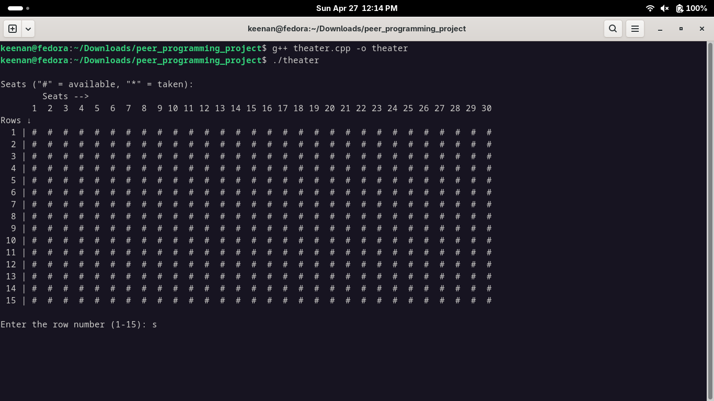

# Theater Seating Reservation System

## Overview

A command-line theater seating reservation system developed
in C++. The application allows users to reserve seats, view
seat availability, and calculate ticket sales.

## Screenshot



## Features

- Interactive seating chart with 450 seats.
- 15 rows with 30 seats per row.
- Seat reservation and availability tracking.
- Prevention of duplicate reservations.
- User input validation and error handling.
- Automatic ticket sales calculations.
- Final seating chart and sales summary.

## Technologies Used

- C++
- C++ Standard Library
- Two-dimensional arrays
- Functions
- Loops and conditional statements
- Input validation

## Installation

Clone the repository:

```bash
git clone https://github.com/keenan-speaks/theater.git
cd theater
```

Compile the application using G++:

```bash
g++ -std=c++11 theater.cpp -o theater
```

Run the application:

```bash
./theater
```

## Usage

1. View the available seats on the seating chart.
2. Enter a row number between 1 and 15.
3. Enter a seat number between 1 and 30.
4. Review the reservation confirmation and current sales.
5. Enter Y to reserve another seat or N to finish.

### Seating Chart EX.o


- `#` - Available seat
- `*` - Reserved seat

Each ticket costs $11.75.

## Learning Objectives

This project demonstrates fundamental programming concepts,
including array manipulation, modular programming, input
validation, problem-solving, and program control flow.


